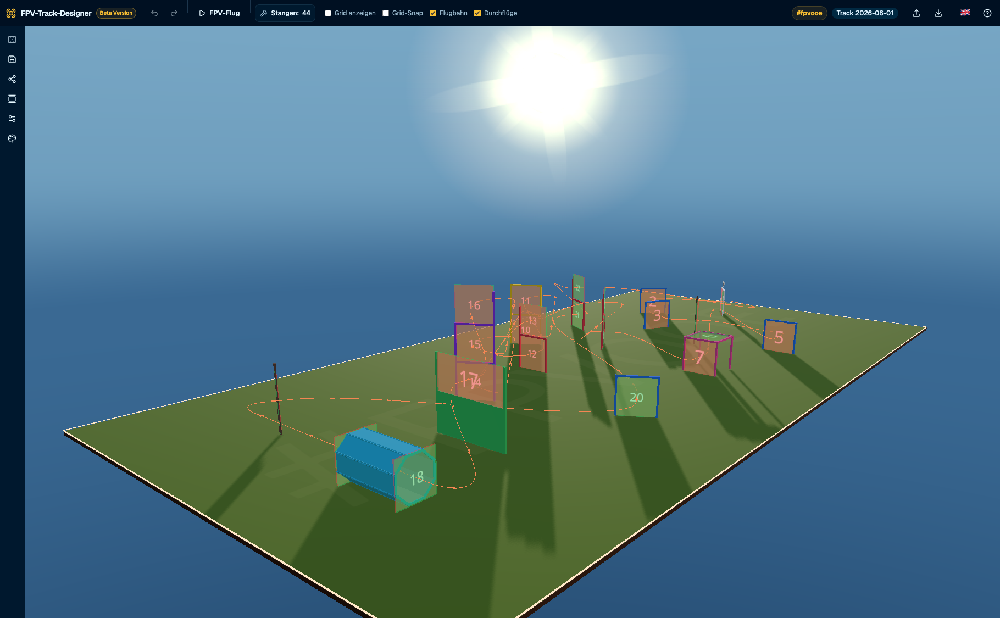

# FPV Track Designer

Ein desktop-orientierter 3D-Editor zum Entwerfen, Generieren und Speichern von FPV-Drohnen-Rennstrecken direkt im Browser.

Das Projekt kombiniert eine interaktive React-Oberfläche mit einer Three.js/R3F-Szene. Strecken können automatisch generiert, über einzelne Gates feinjustiert und lokal als JSON-ähnliche Track-Daten gespeichert werden.

[](public/screenshot.png)

## Features

- **3D-Streckeneditor** mit frei sichtbarer FPV-Rennstrecke
- **Zufällige Track-Generierung** anhand von Feldgröße und Gate-Anzahl je Typ
- **11 Gate-Typen**: Standard, Start/Ziel, h-Gate, Doppel-h, Hurdle, Dive, Doppel, Leiter, Flagge, Flagge klein und Tunnel
- **Gate-Bearbeitung** direkt in der Szene: auswählen, verschieben, anheben, drehen, einfügen und löschen
- **Flugpfad-Visualisierung** mit Gate-Reihenfolge, Richtungspfeilen und automatischen Ausweichkurven
- **Freie Ideallinien-Bearbeitung**: Per Hover das Plus auf der Flugbahn anklicken und zwischen zwei Aktionen wählen: ein neues Gate an dieser Stelle einfügen oder einen frei verschiebbaren Leitpunkt setzen, um die Linie zu formen
- **FPV-Flug** entlang der Ideallinie (ab zwei Gates)
- **Undo/Redo-Verlauf** für Bearbeitungsschritte
- **Lokale Speicherung** von Tracks im Browser über `localStorage`
- **Track-Galerie** zum Laden, Duplizieren und Löschen gespeicherter Strecken
- **JSON-Import und -Export** für den Austausch von Strecken
- **Teilen per Link**: Langlink, Kurzlink und QR-Code als PNG oder SVG
- **Read-only Share-Viewer** auf eigener URL inklusive JSON-Download und FPV-Flug
- **Design-Panel** mit den Themes Minimal Standard, Realistisch und Nacht
- **Sprachumschaltung** zwischen Deutsch und Englisch
- **Stangenzähler** mit Aufschlüsselung der benötigten Stangen je Gate-Typ
- **Keyboard-Shortcuts** für schnelle Bedienung

## Tech Stack

- [React](https://react.dev/) 19
- [TypeScript](https://www.typescriptlang.org/)
- [Vite](https://vite.dev/)
- [React Three Fiber](https://r3f.docs.pmnd.rs/) und [Drei](https://github.com/pmndrs/drei)
- [Zustand](https://zustand-demo.pmnd.rs/) für globalen State
- [Tailwind CSS](https://tailwindcss.com/) v4
- [shadcn/ui](https://ui.shadcn.com/) Komponenten
- [Vitest](https://vitest.dev/) für Tests

## Voraussetzungen

- Node.js 20.19+ oder 22.12+ empfohlen (die Build-Toolchain verlangt `^20.19.0 || >=22.12.0`)
- npm

## Installation

```bash
git clone <repository-url>
cd fpv-track-designer
npm install
```

## Entwicklung starten

```bash
npm run dev
```

Die App läuft anschließend standardmäßig unter:

```text
http://localhost:5173
```

## Nützliche Skripte

```bash
npm run dev           # Entwicklungsserver starten
npm run build         # TypeScript prüfen und Editor-Produktions-Build erstellen
npm run build:viewer  # Share-Viewer als einzelne HTML-Datei nach dist-viewer/ bauen
npm run build:all     # Editor- und Viewer-Build nacheinander ausführen
npm run preview       # Editor-Produktions-Build lokal ansehen
npm run lint          # ESLint ausführen
npm run test          # Vitest starten
```

## Bedienung

### Oberfläche im Überblick

- **TopBar (oben):** links der App-Titel mit dem Badge „Beta Version“; in der Mitte Rückgängig/Wiederholen, der FPV-Flug, der Stangenzähler und die Anzeige-Schalter (Raster, Grid-Snap, Snap-Genauigkeit, Flugbahn, Durchflüge); rechts JSON-Import und -Export, das „#fpvooe“-Badge (Link auf fpvooe.com), der Name der geladenen Strecke, die Sprachumschaltung und der Hilfe-Button.
- **Linke Werkzeugleiste:** Shuffle, Speichern, Track teilen, Galerie, Einstellungen und Design.
- **3D-Szene (Mitte):** die Strecke selbst. Angeklickt erscheinen direkt am Gate die Bearbeitungswerkzeuge. In der Feldmitte liegt ein dezentes Wasserzeichen „#FPVOOE“.

Der Hilfe-Button öffnet einen Dialog mit bebilderten Bearbeitungsschritten und den gruppierten Tastenkürzeln (auf dem Mac mit ⌘-Anzeige); beim ersten Besuch öffnet er sich einmalig von selbst.

Läuft beim Rendern etwas schief, zeigt die App statt der Szene einen Fehlerbildschirm („Etwas ist schiefgelaufen“) mit einem „Erneut versuchen“-Button.

### Strecke konfigurieren

Über die Einstellungen lassen sich die Anzahl der Gates je Typ sowie die Feldbreite und -länge anpassen. Beim Mischen wird daraus automatisch eine neue Strecke erzeugt. „Auf Standard zurücksetzen“ stellt die Werkseinstellungen der Konfiguration wieder her.

Änderungen an der Konfiguration erzeugen die Strecke nicht von selbst neu. Sobald die aktuelle Strecke von der Generierungs-Konfiguration abweicht, erscheint im Einstellungs-Panel der Button „Neue Kurskonfiguration anwenden“, der einen neuen Track erzeugt.

Die Anzeigeoptionen sitzen nicht in den Einstellungen, sondern als Schalter in der TopBar: Raster, Flugbahn und Durchflüge lassen sich dort einzeln ein- und ausblenden.

### Gates bearbeiten

1. Gate in der 3D-Szene anklicken. Shift-, Cmd- oder Ctrl-Klick erweitert die Auswahl.
2. Verschieben-, Anheben- oder Drehen-Werkzeug direkt am Gate verwenden. Das Drehen läuft kontinuierlich mit 1° pro Pixel und rastet nur bei aktivem Snap auf 15°-Schritte ein. Alternativ hebt und senkt **`Shift` + Ziehen am Gate** die Höhe direkt, ohne das Höhen-Werkzeug zu greifen.
3. **Einflug- und Ausflugseite:** Bei aktivem Schalter „Durchflüge“ zeigt jede Öffnung eine grüne Einflug- und eine rote Ausflugsfläche; das ⇄-Symbol an der Öffnung dreht die Durchflugrichtung um. Je nach Kameraposition ist nur die zugewandte Seite beschriftet.
4. **Durchflugreihenfolge:** Ein Klick auf die Durchflugnummer einer Öffnung öffnet den Dialog „Durchflugnummer ändern“. Die Nummer muss zwischen 1 und der Gesamtzahl der Durchflüge liegen.
5. Neue Gates können relativ zu einem ausgewählten Gate davor oder danach eingefügt werden. Beim Einfügen wird der Gate-Typ gewählt; ein bereits vorhandenes Start/Ziel-Gate ist ausgegraut.
6. Ausgewählte Gates lassen sich per Dialog oder Shortcut löschen.
7. Ein Klick auf den Boden hebt die Auswahl wieder auf.

### Ideallinie mit Leitpunkten formen

Aktiviere in der TopBar **„Flugbahn“**. Solange kein Gate ausgewählt ist, kannst du die Ideallinie bearbeiten.

1. Fahre mit der Maus über die Linie. Ein **Plus-Zeichen** erscheint direkt unter dem Mauszeiger; klicke auf die Linie, um zwei Symbole aufzuklappen (ein zweiter Klick schließt sie wieder).
2. Das **Gate-Symbol** öffnet den bekannten Dialog „Gate einfügen“. Das neue Gate landet genau auf der Linie, ist entlang der Linie ausgerichtet und wird in der Durchflugreihenfolge zwischen den beiden Gate-Ankern dieses Abschnitts eingefügt.
3. Das **gelbe Punkt-Symbol** setzt genau einen Leitpunkt an dieser Stelle.
4. Klicke den neuen gelben Leitpunkt an. Über ihm erscheinen zwei Werkzeuge wie bei Gates: **Verschieben** bewegt den Leitpunkt in der Feldebene (X/Z), **Höhe** hebt oder senkt ihn um 0,03 m pro Pixel (Y). Feldgrenzen und Grid-Snap wirken wie bei Gates. Der kleine Papierkorb oben rechts am Leitpunkt löscht ihn.
   Genau wie bei Gates geht es auch direkt am Leitpunkt: **Leitpunkt gedrückt halten und ziehen** verschiebt ihn in der Feldebene, **`Shift` + Leitpunkt gedrückt halten und ziehen** nur in der Höhe. Ein kurzer Klick ohne Ziehen wählt den Leitpunkt weiterhin nur aus.
5. Füge bei Bedarf weitere Leitpunkte ein. Die Linie verläuft glatt durch alle Leitpunkte eines Gate-Abschnitts; die Gate-Anker bleiben unverändert.
6. Einfügen, Löschen und jede komplette Ziehbewegung sind jeweils ein Rückgängig-Schritt.

Die Leitpunkte werden mit ihrer Weltposition und ihrer Zuordnung zum Gate-Abschnitt gespeichert. Gate-Bearbeitungen behalten diese Daten; Leitpunkte eines nicht mehr vorhandenen Abschnitts bleiben gespeichert, sind aber wirkungslos. Speichern, JSON-Export/Import und Teilen übernehmen die Leitpunkte.

### FPV-Flug

Der Play-Button in der TopBar startet einen automatischen Kameraflug entlang der Ideallinie, ein erneuter Klick stoppt ihn. Der Flug ist erst ab zwei Gates verfügbar, darunter bleibt der Button deaktiviert. `Escape` beendet den Flug ebenfalls und stellt die vorherige Editor-Kamera wieder her. Die Geschwindigkeit ist fest (4 m/s), die Kamera blickt der Linie voraus, und eine Fortschrittsanzeige gibt es nicht. Während des Flugs sind die Kamera-Bedienelemente deaktiviert.

### Design und Themes

Das Design-Panel bietet drei Themes: Minimal Standard, Realistisch und Nacht. Ein Klick schaltet die Szene sofort um. Realistisch rendert Sonne, Umgebungslicht und Schatten, Nacht einen Sternenhimmel mit Bloom- und Neon-Effekt auf den Gates.

### Sprache

Der Flaggen-Button in der TopBar schaltet die komplette Oberfläche zwischen Deutsch und Englisch um. Standard ist Deutsch.

### Maussteuerung in der 3D-Ansicht

Die Ansicht kann vollständig mit der Maus bedient werden:

| Aktion | Mausbedienung |
| --- | --- |
| Ansicht drehen | Linke Maustaste gedrückt halten und ziehen |
| Über die Strecke bewegen | Rechte Maustaste gedrückt halten und ziehen (draggen/pannen) |
| Zoomen | Mausrad scrollen |
| Schnell zoomen | Mittlere Maustaste gedrückt halten und ziehen |
| Neigung der Ansicht | Die Kamera lässt sich nicht unter den Horizont kippen |
| Zoom-Grenzen | Der Abstand reicht von 2 m bis 200 m |

Alternativ kann die Ansicht auch mit `Space + linke Maustaste ziehen` verschoben werden.

Auf Touch-Geräten verschiebt ein Zwei-Finger-Ziehen die Ansicht, ein Auf- und Zuziehen mit zwei Fingern zoomt.

### Shortcuts

| Aktion | Shortcut |
| --- | --- |
| Strecke shuffeln | `S` |
| Strecke speichern | `Cmd/Ctrl + S` |
| Galerie öffnen | `G` |
| Ansicht verschieben | `Space + linke Maustaste ziehen` |
| Gate anheben oder absenken | `Shift` gedrückt halten und Gate ziehen |
| Leitpunkt anheben oder absenken | `Shift` gedrückt halten und Leitpunkt ziehen |
| Gate abwählen / Dialoge schließen | `Escape` |
| FPV-Flug beenden | `Escape` |
| Ausgewähltes Gate löschen | `Backspace` |
| Löschen bestätigen | `Enter` |
| Rückgängig | `Cmd/Ctrl + Z` |
| Wiederholen | `Cmd/Ctrl + Y` oder `Cmd/Ctrl + Shift + Z` |

Die Tooltips der Rückgängig-/Wiederholen-Knöpfe in der TopBar zeigen in Klammern, wie viele Schritte gerade verfügbar sind; ohne Verlauf sind die Knöpfe deaktiviert.

### Snap und Raster

Der "Grid-Snap"-Schalter in der TopBar aktiviert das Einrasten und rastet beim Einschalten sofort alle Gates ein. Die Rastergröße lässt sich auf 0,3 m, 0,5 m oder 1,0 m stellen; ein Wechsel rastet alle Gates neu ein. Der separate „Grid anzeigen“-Schalter blendet das Bodenraster mit 1-m-Zellen und 5-m-Markierungen ein oder aus. Der Feldrand wird unabhängig davon immer gezeichnet.

## Teilen

Der „Track teilen"-Button in der linken Werkzeugleiste erzeugt eine Viewer-URL, die die komplette Strecke als komprimierten Hash-Payload trägt (Langlink). Zusätzlich schickt die App den Langlink an einen Shortener-Dienst und zeigt den zurückgelieferten Kurzlink an. Der Share-Dialog zeigt beide Links gleichzeitig, erlaubt das Kopieren und zeigt eine QR-Vorschau, die sich als PNG oder SVG herunterladen lässt.

Die Daten für Lang- und Kurzlink kommen ausschließlich aus der Strecke im Editor. Ohne geladenen Track bleibt der Teilen-Button deaktiviert.

## Share-Viewer

Der Share-Viewer ist eine eigene, read-only Ansicht der geteilten Strecke. Er wird über eine eigene URL mit Hash-Payload aufgerufen und liest die Daten beim Laden direkt aus dem Fragment nach `#`. Fehlt die Payload oder ist sie beschädigt, erscheint statt der Szene eine Fehlermeldung mit dem Titel „Track kann nicht geladen werden“ und einer passenden Meldung.

Im Viewer lässt sich die Strecke frei betrachten, aber nicht verändern. Eine mit Leitpunkten geformte Ideallinie wird angezeigt; die Leitpunkte selbst sind dort nicht sichtbar. Oben rechts gibt es Buttons für den FPV-Flug (ab zwei Gates), den JSON-Download der Strecke und eine Hilfe mit den Steuerungsgesten; die Hilfe öffnet sich beim ersten Besuch einmalig von selbst und danach nur noch per Klick. Der Download benennt die Datei nach dem Streckennamen. Unten rechts führt ein Link zu fpvooe.com. Auch im Viewer beendet `Escape` den FPV-Flug.

Der Viewer wird als einzelne HTML-Datei gebaut und über einen eigenen Einstiegspunkt (`viewer.html`) geladen:

```bash
npm run build:viewer
```

Das Ergebnis landet als `dist-viewer/index.html`. Der Viewer ist damit unabhängig vom Editor deploybar.

## Daten und Speicherung

Die App benötigt kein Backend. Gespeicherte Tracks werden lokal im Browser abgelegt. Dadurch bleiben Daten auf dem Gerät, sind aber auch an den jeweiligen Browser und dessen Speicher gekoppelt.

Eine Ausnahme ist das Erzeugen eines Kurzlinks: Dabei wird die vollständige lange URL inklusive der Track-Daten im Hash an den Shortener-Dienst übermittelt, damit dieser den Kurzlink bauen kann. Ohne diesen Dienst bleibt der Langlink uneingeschränkt nutzbar. Beim reinen Betrachten einer geteilten Strecke werden die Track-Daten ausschließlich im Browser aus dem URL-Fragment gelesen.

Strecken lassen sich in der TopBar als `.json`-Datei exportieren und aus einer `.json`-Datei wieder importieren. Der Import läuft über die Schema-Validierung: Eine ungültige Datei wird abgewiesen und die aktuelle Strecke bleibt unverändert, die App stürzt dabei nicht ab. Eine sichtbare Fehlermeldung im UI gibt es derzeit noch nicht, der Fehler landet nur in der Browser-Konsole. Die gleiche Validierung schützt auch die per Share-Link übertragenen Daten.

Vor destruktiven Aktionen wie Import, Verwerfen oder Galerie-Laden erscheint bei ungespeicherten Änderungen ein Dialog mit den Optionen „Abbrechen“, „Zuerst speichern“ und „Verwerfen“. Wählst du „Zuerst speichern“, wird die vorgemerkte Aktion nach dem erfolgreichen Speichern automatisch ausgeführt. Beim ersten Besuch wird automatisch eine Strecke generiert und die Hilfe einmalig geöffnet.

## Stangenzähler

Die TopBar zeigt ein Hammer-Badge mit der Gesamtzahl der benötigten Stangen. Ohne Gates wird das Element gar nicht gerendert. Ein Klick öffnet eine Aufschlüsselung je Gate-Typ mit Menge, Stangen pro Gate und Zwischensumme.

Nicht alle Gate-Typen lassen sich aus Stangen bauen. Für Hurdle, Dive und den Tunnel ist die Stangenanzahl pro Gate null, sie werden in der Aufschlüsselung separat als nicht aus Stangen baubar geführt.

## Projektstruktur

```text
src/
├── components/
│   ├── gates/        # 3D-Komponenten für Gate-Typen, Handles und Öffnungs-Indikatoren
│   ├── layout/       # TopBar, linke Werkzeugleiste und Stangenzähler
│   ├── scene/        # R3F-Canvas, Kamera, Grid, Flugpfad und FPV-Flug
│   ├── ui/           # Dialoge, Panels und shadcn/ui-Primitives
│   ├── viewer/       # Read-only Share-Viewer-UI
│   ├── icons/        # Gate-Typ-Icons
│   └── ErrorBoundary.tsx  # Fehlergrenze (einzige Klassenkomponente)
├── constants/        # geteilte Gate-Maße
├── hooks/            # Keyboard-, Auswahl- und Theme-Logik
├── lib/              # cn-Helfer für shadcn-Klassen
├── schemas/          # Schema-Validierung (handgeschrieben) für Track-Daten
├── store/            # Zustand-Slices für Config und Tracks
├── types/            # TypeScript-Domänenmodelle
├── utils/            # Generator, Flugpfad, Stangenzählung, Share-Links und Storage
├── i18n.ts           # typisierte DE/EN-Übersetzungen
├── viewer-main.tsx   # Einstieg des Share-Viewers
└── viewer-store.ts   # eigener Zustand-Store für den Viewer
```

## Tests

Die Kernlogik ist mit Vitest abgedeckt, unter anderem für:

- Track-Generierung
- Gate-Öffnungen und Sequenzen
- Flugpfad-Berechnung
- Store-Slices
- LocalStorage-Persistenz
- Schema-Validierung
- Share-Link-Payloads
- QR-Code-Erzeugung
- Stangenzählung
- Keyboard-Shortcuts
- Share-Viewer

```bash
npm run test
```

## Build

```bash
npm run build
```

Der Build führt zuerst den TypeScript-Projektcheck aus und erstellt danach die optimierten Vite-Assets in `dist/`.

Der Viewer hat einen eigenen Build (`npm run build:viewer`) nach `dist-viewer/`, der beide Builds laufen mit `npm run build:all` nacheinander. Editor und Viewer sind getrennte Deployments: Der Editor-Container liefert `dist/`, der Viewer-Container die einzelne Datei aus `dist-viewer/`.

## Weiterführende Dokumentation

- [Ausführliche Anleitung](./docs/NUTZERDOKUMENTATION.md)
- [Deployment und Teilen-Technik](./docs/coolify-track-sharing.md)

## Lizenz

Dieses Projekt ist unter der GNU General Public License v3.0 lizenziert.
Details stehen in der Datei [LICENSE](./LICENSE).
